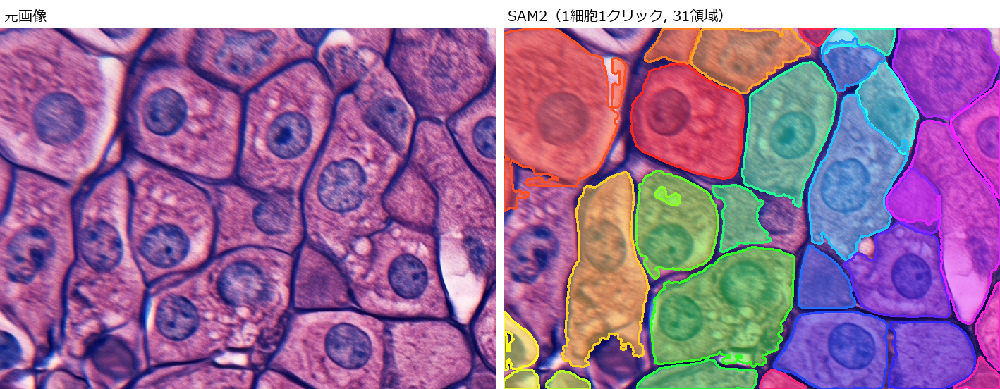

# sam2-validation

画像上をクリックするだけで、[SAM2 (Segment Anything Model 2)](https://github.com/facebookresearch/sam2) による
セグメンテーションを試せるツールです。Hugging Face `transformers` の SAM2 実装と Gradio で動作します。



## 機能

- クリックした位置の物体をセグメンテーションし、色分けして重ねて表示
- 複数の物体を続けて選択可能
- 複数の位置をまとめて選択してから、一括で推論
- 塗りつぶし表示と輪郭線表示の切り替え
- クリック位置を含まない小さな領域を除去する後処理
- マスクの輪郭座標（ポリゴン）を JSON で表示
- 座標を指定して推論するコマンドラインツール

## 動作環境

- Python 3.14
- GPU は不要です（CPU で動作します）
- Windows 11 / Python 3.14 で動作確認しています

モデル（`facebook/sam2-hiera-tiny`）は、初回実行時に Hugging Face Hub から自動でダウンロードされます。

## インストール

```bash
git clone https://github.com/K-KN0426/sam2-validation.git
cd sam2-validation
pip install -r requirements.txt
```

## 使い方

### ブラウザで使う

```bash
python app.py
```

ブラウザで http://127.0.0.1:7860 を開き、画像をアップロードして、選択したい物体をクリックします。

画面上部のチェックボックスで、次の設定を切り替えられます。

| 設定 | 内容 |
| --- | --- |
| まとめて選択してから実行 | クリックした位置を貯めておき、「選択を実行」ボタンでまとめて推論します |
| 外枠の線で表示 | マスクを塗りつぶしではなく輪郭線で表示します |
| クリックした塊だけ残す | クリック位置を含まない小さな領域をマスクから取り除きます（初期状態で ON） |

「選択をリセット」ボタンで、選択をすべて解除できます。

### コマンドラインで使う

```bash
python scripts/sam2_validation.py --image assets/sample.png --point 320 240 --output outputs/sample_mask.png
```

| 引数 | 内容 |
| --- | --- |
| `--image` | 入力画像のパス |
| `--point X Y` | 選択したい物体のピクセル座標 |
| `--output` | 結果画像の保存先 |
| `--model-id` | 使用するモデル（省略時は `facebook/sam2-hiera-tiny`） |

## サンプル画像

`assets/` にサンプル画像を同梱しています。一部は AI で生成した画像です。
詳細は [assets/README.md](assets/README.md) を参照してください。

## ライセンス

[Apache License 2.0](LICENSE)

### 依存ライブラリ・モデル

以下はこのリポジトリには含まれておらず、インストール時・実行時に取得されます。それぞれのライセンスに従います。

| 名前 | ライセンス |
| --- | --- |
| [PyTorch](https://github.com/pytorch/pytorch) (`torch`) | BSD-3-Clause |
| [torchvision](https://github.com/pytorch/vision) | BSD-3-Clause |
| [transformers](https://github.com/huggingface/transformers) | Apache-2.0 |
| [Pillow](https://github.com/python-pillow/Pillow) | MIT-CMU |
| [NumPy](https://github.com/numpy/numpy) | BSD-3-Clause |
| [Gradio](https://github.com/gradio-app/gradio) | Apache-2.0 |
| [opencv-python-headless](https://github.com/opencv/opencv-python) | Apache-2.0 |
| [SAM2](https://github.com/facebookresearch/sam2) | Apache-2.0 |
| [facebook/sam2-hiera-tiny](https://huggingface.co/facebook/sam2-hiera-tiny)（モデルの重み） | Apache-2.0 |
